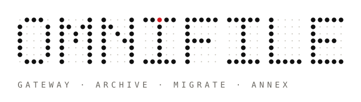
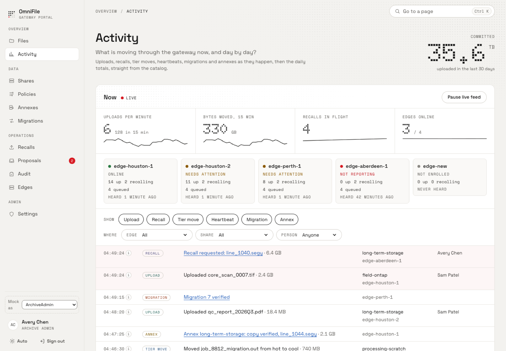
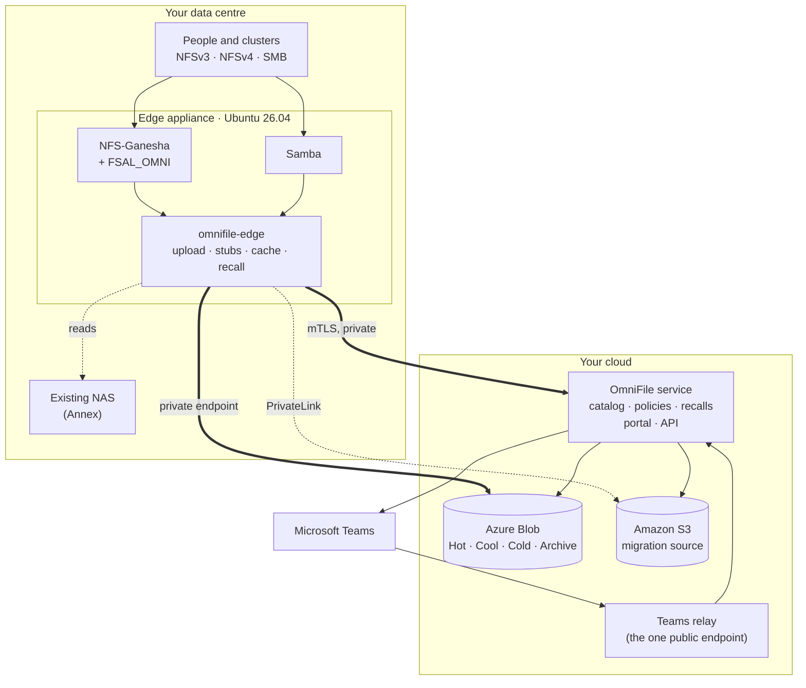
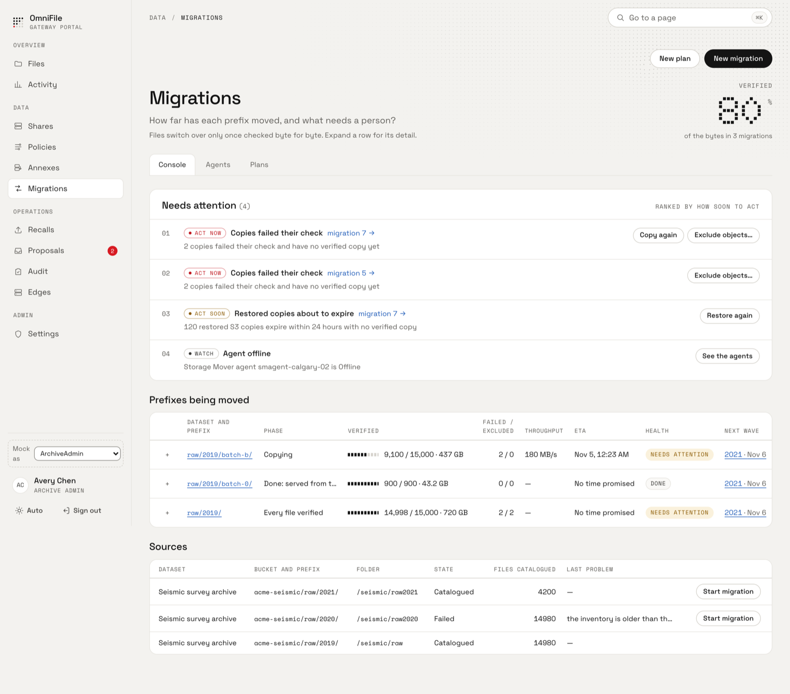
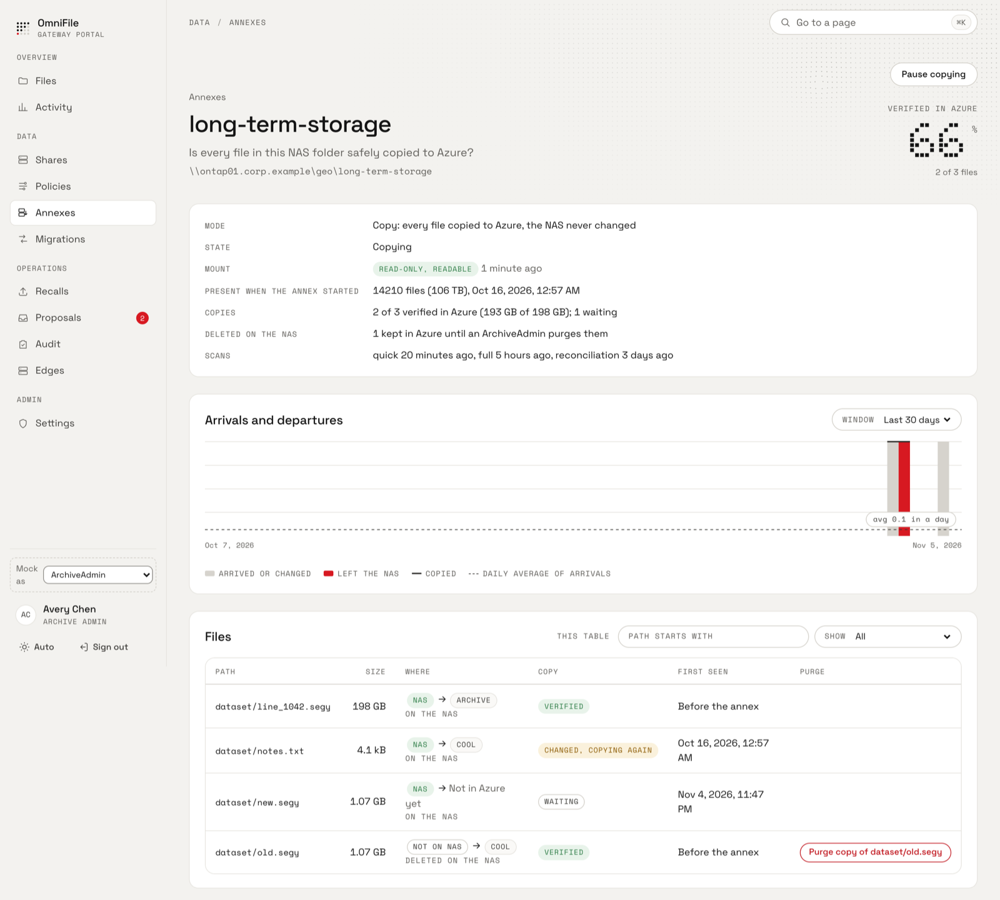
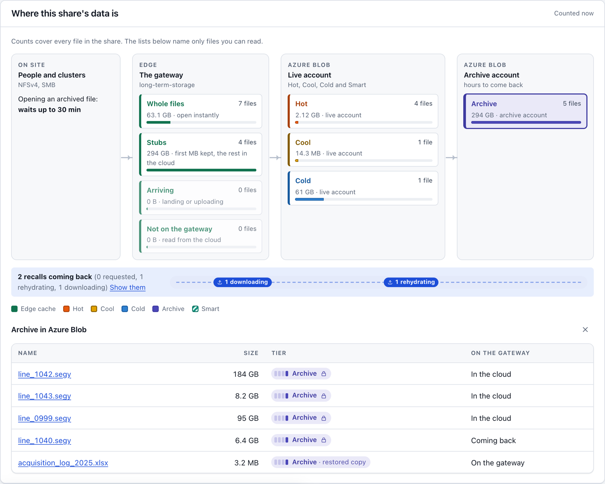
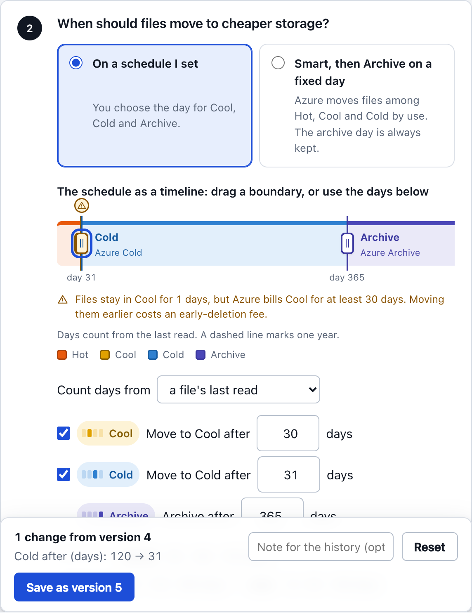

<p align="center">
  <picture>
    <source media="(prefers-color-scheme: dark)" srcset="docs/assets/readme/banner-dark.svg">
    
  </picture>
</p>

<p align="center">
  <b>A file gateway that archives to the cloud, brings files back when someone opens them,<br>
  and moves whole estates between clouds while users keep the same share.</b>
</p>

<p align="center">
  <a href="LICENSE"></a>
  
  
  
  
</p>

<p align="center">
  <a href="#what-it-does">What it does</a> ·
  <a href="#how-it-works">How it works</a> ·
  <a href="#the-portal">The portal</a> ·
  <a href="#where-it-stands">Where it stands</a> ·
  <a href="#build-and-test">Build and test</a> ·
  <a href="#documentation">Docs</a> ·
  <a href="#licence">Licence</a>
</p>

<picture>
  <source media="(prefers-color-scheme: dark)" srcset="docs/assets/readme/activity-dark.png">
  
</picture>

---

OmniFile Gateway is a Linux appliance that sits in your data centre and serves ordinary **NFS and SMB
shares**. Behind them, every file is copied to your own cloud storage as a **plain object** that any cloud
tool can read, tiered down to **Archive** on a schedule you set, and brought back the moment someone
needs it. People keep their drive letters and mount points; the storage bill keeps shrinking.

It is in the spirit of Azure Data Box Gateway, with three things that gateway doesn't have: archive and
recall as first-class features, **migrations between clouds** that users never notice, and an **Annex**
that protects an existing NAS without sitting in front of it.

## What it does

A geoscientist copies a 184 GB survey line, `line_1042.segy`, to `/long-term-storage` on the share.

1. **The gateway notices the write is finished** (a quiet period plus a SEG-Y structure check), hashes
   the file and uploads it to Azure Blob as a plain block blob.
2. **The file tiers down on the client's schedule**: Hot, then Cool, then Cold, then Archive, or Azure's
   Smart tier with a fixed archive date. The local copy becomes a stub that keeps the first few MB, so
   headers still read instantly and the disk is freed.
3. **Day 45: someone opens it.** The gateway knows who, from Active Directory, starts the recall and,
   depending on the share, either holds the read until the bytes arrive (for batch clusters) or fails
   fast with a clear note beside the file (for people).
4. **They get a Microsoft Teams card** with *Recall*, *Keep online* and *Track* buttons, and the card
   updates as the recall moves along.
5. **The portal shows every file's tier**, lets people recall ahead of time, and lets admins edit the
   policies in plain language.

| | |
|---|---|
| **Shares that archive themselves** | NFSv3, NFSv4.x and SMB from one appliance. Files leave the disk as stubs and come back on read. |
| **Fail-closed stubs** | An unfilled byte never reads as zeros: if the daemon dies, reads of a stub fail rather than return silence. Proven under kill, restart and a 6-hour chaos soak. |
| **Active Directory everywhere** | The same AD groups decide access over NFS, SMB, the portal, Teams, the API and files still sitting in S3. Kerberos per share. |
| **Migrations users don't see** | During a move from Amazon S3, the share shows files wherever their bytes are right now. Each file switches over only after its copy is verified byte for byte. |
| **The Annex** | Point it at a folder on an existing NFS or SMB filer and it copies every file to the cloud, verified. A file leaves the filer only under rules an admin approved, after a dry run. |
| **Versions, rewind and WORM** | Every committed write is a version. Rewind a folder to a date in the portal, or browse `.snapshots/` over NFS and Previous Versions over SMB. WORM per share, one way. |
| **Native cloud tools first** | Batch Operations, Storage Mover, the Blob change feed, managed identities and IAM Roles Anywhere do the heavy lifting. No long-lived cloud keys anywhere. |
| **Private by default** | Storage is reached over private endpoints. The only public endpoint is a thin relay for Teams button clicks. |
| **No lock-in** | Your data stays as ordinary objects in your own account, readable without OmniFile. |

## How it works



- **The edge** is a minimized Ubuntu appliance. NFS goes through NFS-Ganesha with our own FSAL module, so
  every read is seen with the caller's identity; SMB goes through Samba, guarded by fanotify pre-content
  events. A Rust daemon does uploads, stubs, the cache and recalls.
- **The service** runs in your own cloud subscription: a container app and PostgreSQL holding the catalog,
  the policy engine, the recall orchestrator, the portal and the partner API.
- **Integrity is CRC64-NVME end to end**, the same checksum Azure and S3 compute, so every copy is checked
  without an extra read pass.

More in [`docs/ARCHITECTURE.md`](docs/ARCHITECTURE.md) and the anchor document, [`AGENTS.md`](AGENTS.md).

## The portal

Plain-language questions up front, every knob one click down.

<table>
  <tr>
    <td width="50%" valign="top">
      <b>Migrations</b>: what needs a person, ranked by how soon<br><br>
      <picture>
        <source media="(prefers-color-scheme: dark)" srcset="docs/assets/readme/migrations-dark.png">
        
      </picture>
    </td>
    <td width="50%" valign="top">
      <b>Annexes</b>: is every file on this NAS safely copied?<br><br>
      <picture>
        <source media="(prefers-color-scheme: dark)" srcset="docs/assets/readme/annex-dark.png">
        
      </picture>
    </td>
  </tr>
  <tr>
    <td width="50%" valign="top">
      <b>Share map</b>: where a share's data is right now<br><br>
      <picture>
        <source media="(prefers-color-scheme: dark)" srcset="docs/assets/readme/share-map-dark.png">
        
      </picture>
    </td>
    <td width="50%" valign="top">
      <b>Policies</b>: drag the schedule, see the cost warnings<br><br>
      <picture>
        <source media="(prefers-color-scheme: dark)" srcset="docs/assets/readme/policy-timeline-dark.png">
        
      </picture>
    </td>
  </tr>
</table>

## Where it stands

**Pre-release.** The product is built end to end and tested hard against simulated clouds; the runs on
real clouds have just begun.

| | |
|---|---|
| **Built and passing their exit tests** | NFS and SMB with fail-closed stubs · AD identity and ACLs · tiering, Archive, versioning and WORM · Teams cards and the portal · S3-resident files during migrations |
| **Built, exits waiting on real accounts** | The appliance image and setup wizard · the Azure deployment · observability · the threat model and security review · scale (catalog seeding at 16,500 files a second, 17,000 concurrent readers) and chaos tests · the Annex |
| **On real AWS** | 11 checks pass and none fail ([`real-aws-checks.md`](docs/milestones/real-aws-checks.md)); the first runs found and fixed three bugs no fake could |
| **Not yet** | Real Azure, a real Teams tenant, Windows clients, a first client site |
| **Planned** | Amazon S3 and Google Cloud Storage as homes, not only sources, and the service on any of the three clouds ([`multicloud.md`](docs/design/multicloud.md)) |

## Repository

| Path | What | Language |
|---|---|---|
| [`edge/`](edge) | The edge daemon and tools: upload, stubs, cache, recall, the setup wizard | Rust |
| [`fsal/`](fsal) | The NFS-Ganesha module `FSAL_OMNI` | C (LGPL-3.0) |
| [`samba-vfs/`](samba-vfs) | The Samba module for Previous Versions | C (GPL-3.0) |
| [`appliance/`](appliance) | The appliance image (mkosi), its formats and qemu tests | shell, Python |
| [`service/`](service) | The control plane: catalog, policies, backends, APIs, Teams | Python |
| [`relay/`](relay) | The Teams relay, the only public endpoint | Python |
| [`portal/`](portal) | The web portal | TypeScript, React |
| [`deploy/`](deploy) | The Azure deployment (Bicep) and the AWS setup | Bicep, CloudFormation |
| [`tests/`](tests) | End-to-end, chaos, scale and real-cloud tests | shell, Python |
| [`docs/`](docs) | Architecture, decisions, designs, milestones and the customer guide | |

## Build and test

Each part runs its own lane; there is no hosted CI.

```bash
cd service && uv run pytest -q          # control plane (needs PostgreSQL 17)
cd portal && npm ci && npm test         # portal
cd edge && cargo test && cargo clippy --all-targets -- -D warnings
deploy/azure/check.sh                   # Bicep build and lint
docs/guide/check.sh && docs/guide/test.sh
```

The end-to-end exit tests in [`tests/e2e/`](tests/e2e) run on Lima VMs defined in [`dev/`](dev) (Ubuntu
26.04, kernel 7.0, joined to a Samba AD domain controller).

## Documentation

- [**`AGENTS.md`**](AGENTS.md): the anchor document. What the product is, every closed decision, and
  where each part stands.
- [**Customer guide**](docs/guide/README.md): deploying it, step by step.
- [**Decisions**](docs/DECISIONS.md) · [**Architecture**](docs/ARCHITECTURE.md) ·
  [**Designs**](docs/design) · [**Threat model**](docs/design/threat-model.md) ·
  [**Milestones**](docs/milestones)

## Licence

**Business Source License 1.1** ([`LICENSE`](LICENSE)): source-available, not open source. Production use
is free for organisations with fewer than 100 people and under US$1M in revenue; others need a commercial
licence from AiLuxis Research. Each version becomes **Apache-2.0** four years after it is published.
`fsal/` is LGPL-3.0 and `samba-vfs/` is GPL-3.0-or-later. Every dependency and its licence:
[`LICENSES.md`](LICENSES.md).

Outside contributions aren't accepted yet; bug reports and questions are welcome
([`CONTRIBUTING.md`](CONTRIBUTING.md)).
